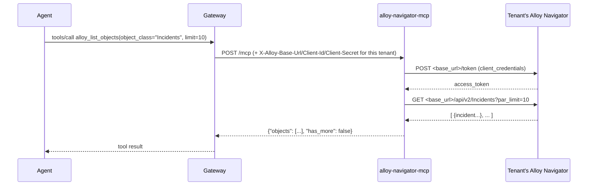

# PRD-21267 · [Ticketing] Alloy Navigator

Ticket: https://app.clickup.com/t/PRD-21267
Repo: https://github.com/MSPbotsAIFramework/alloy-navigator-mcp.git@main (e3da08a)
Work branch: dev/PRD-21267
Status: in progress

## Requirement understanding

One line: Review incidents, computers, work orders, and other objects/activity via Alloy Navigator's flexible ITSM API.

Mandy Du (creator) and Ken Lee (0.1 Requester) opened this ticket on 2026-10-23 asking for an Agent Platform connector to Alloy Navigator, an IT asset management / ITSM product. The description is a one-line capability summary plus a link to the marketplace page `https://conduit.wyre.ai/plugins/alloy`; there is no further elaboration in the description or any product/BA comment — this is a "New Integration MCP" leaf under the MCP Epic sweep (parent `86e3v6bb7`), not a request to change an existing connector. Success looks like: an Agent, given a tenant's Alloy Navigator credentials, can read incidents, computers, work orders, their activity history, and other object classes the vendor's API exposes, without being able to create, modify, or delete anything (the ask is "review", a read verb, in every occurrence).

## Current state

There is no MSPbots connector for Alloy Navigator today. The repo `MSPbotsAIFramework/alloy-navigator-mcp` was created by an org admin on 2026-11-02 (commit `e3da08a`, "Initial commit") after a GitHub-permission blocker (see prior `[BLOCKED · vendor-mcp]` comment, 2026-10-30) — it contains only a two-line `README.md` ("alloy-navigator-mcp" / "MCP server for Alloy Navigator"), no source, no tools, no tests. This is confirmed by reading the worktree directly: `README.md` is the only file in the tree at `main@e3da08a`.

No MSPbots wiki page covers Alloy Navigator: `mbp.py wiki find "Alloy Navigator"` and `wiki find "ITSM"` both return zero hits against `ProductDocs/**` (synced 2026-11-02, product version `v20261102.0940`) — wiki not covered for this vendor. The platform-side mechanism that this connector will eventually be published through is covered: `ProductDocs/18-Dev.md § Published Connectors` (`_verified_ 2026-09-11`) describes an admin page where a connector is pushed to tenants and then appears under "MSPbots Connectors" in each tenant's Capabilities; that page is out of scope for this ticket (publishing is done by the review leg via `mcppub`, not by hand here).

## Product design

### Goals / Non-goals

Goals:
- Give an Agent read access, through MSPbots-issued credential headers, to Alloy Navigator's core ITSM object model: Incidents, Computers, Work Orders, and — because the vendor's own API is generic over "object class" rather than exposing one endpoint per resource type — any other object class the tenant's Alloy Navigator instance defines (the ticket says "and other objects/activity").
- Let the Agent read an object's activity/history log (notes, status changes) for the objects above.
- Let the Agent resolve the coded classification values (status, priority, and similar dictionary-backed fields) that Alloy Navigator returns, so a raw code like a priority id can be shown as a human label.

Non-goals (v1):
- No create, update, delete, or "run action" tools. The ticket's verb is "review"; nothing in the description or the vendor's own capability list implies a write need. Alloy Navigator's API does expose `POST /api/v2` (create) and `POST /api/v2/object/<oid>/action/<actionId>` (run a workflow action) — both are left out of v1 scope; adding them later is an additive, non-breaking change (new tools), not a redesign.
- No attachment download/upload (`/api/v2/Object/<oid>/Attachments>`). Not asked for; binary payloads also don't fit the MCP text-return contract well without extra design (presigned links, size limits) that nothing in this ticket calls for.
- No SSO/user-level ("password" grant) authentication path. The service account model (`client_credentials`) is the one documented for machine-to-machine integrations and is what every other MSPbots MCP connector uses; per-human-user login is out of scope.
- No per-tenant configuration UI. Like every other vendor-mcp connector, credentials are supplied per request via headers (see Tech design §5); there is no MSPbots-side settings screen to design.

### Main flow

1. A tenant's Alloy Navigator administrator creates a service account ("Application") in their own Alloy Navigator instance (Settings → Services → API → Applications) and gives MSPbots the resulting Application ID, Application Secret, and their instance's API base URL.
2. An MSPbots admin registers those three values as the tenant's credentials for this connector (standard Published Connectors flow, `ProductDocs/18-Dev.md`), which the Gateway then injects as HTTP headers on every call to this MCP service.
3. An Agent conversation that needs ITSM information calls one of this connector's tools (list objects of a class, get one object, get its activity history, or resolve a dictionary's values). The service exchanges the tenant's Application ID/Secret for a bearer token against that tenant's own base URL, calls the corresponding Alloy Navigator endpoint, and returns a trimmed, agent-sized JSON result.
4. If the tenant's Alloy Navigator instance is unreachable, the credentials are wrong, or the requested object class/id doesn't exist, the Agent gets a structured error it can reason about (retry, say "not found", or ask a human) instead of a stack trace.

### Boundaries & exceptions

- Listing with no matches (e.g. a search term nobody's incident matches) returns an empty result, not an error — this mirrors the general MCP error-code contract (`not_found` is reserved for "this specific ID doesn't exist").
- A request for an object class the tenant's instance doesn't define, or a malformed class name, is rejected by Alloy Navigator itself (its API is schema-driven per instance) and surfaces to the Agent as a structured `invalid_argument`, not a crash.
- Credential headers missing or wrong → the Agent never reaches Alloy Navigator; it gets a 401 listing which header(s) are missing (platform-wide contract, not specific to this connector).
- Alloy Navigator being slow/down (self-hosted, customer-operated instances vary widely in availability) surfaces as a retryable `upstream_error`, not a hang — see Tech design §7 for timeout and retry numbers.

### Multi-tenant & permissions

Every tenant supplies its own Application ID/Secret/base URL; nothing is shared across tenants, and nothing issued for one tenant is ever used to serve another tenant's request — this is a direct instance of the platform-wide "credentials only from per-request headers, no cross-request caching" rule (Tech design §7, AC8). There is no MSPbots-side role/permission layer for this connector beyond what the Gateway already enforces for who can call a tenant's MCP tools at all; inside Alloy Navigator itself, what the Application account can see is controlled entirely by the tenant's own Alloy Navigator administrator (the service account's read scope), which is outside this connector's code.

### Acceptance criteria

- AC1: Given valid credential headers and an object class that exists in the tenant's Alloy Navigator instance (e.g. "Incidents", "Computers", "Work Orders"), when the Agent asks to list objects of that class, then it gets back a JSON array of matching objects (respecting any limit/search/sort it specified), and an empty array (not an error) when nothing matches.
- AC2: Given a known object id, when the Agent asks for that object's detail, then it gets back that single object's fields.
- AC3: Given a known object id, when the Agent asks for that object's activity history, then it gets back the object's activity/history entries (e.g. status changes, notes) in order.
- AC4: Given the name of a classification/dictionary (e.g. the set of valid incident priorities), when the Agent asks to resolve it, then it gets back the code→label values for that classification.
- AC5: Given a request missing one of the three required credential headers, when any tool is called, then the Agent gets a 401 naming the missing header(s), and Alloy Navigator is never called.
- AC6: Given an object class name Alloy Navigator doesn't recognize, when the Agent lists that class, then it gets a structured "invalid argument" error, not an unhandled exception.
- AC7: Given an object id that doesn't exist, when the Agent asks for that object's detail, then it gets a structured "not found" error.
- AC8: Given two concurrent requests carrying two different tenants' credentials, when both are in flight at the same time, then each is served with only its own tenant's credentials and data — one tenant's Application Secret is never sent on the other tenant's behalf.
- AC9: Given Alloy Navigator's instance is unreachable or returns a server error, when any tool is called, then the Agent gets a structured, retryable "upstream error", not a hang or a stack trace.

### Open questions

- [non-blocking] Alloy Navigator's documented token lifetime is roughly 8 hours; v1 mints a fresh token on every tool call rather than caching it (Tech design §3), trading a small amount of latency for not having to reason about cross-request token cache safety in a multi-tenant stateless service. If call volume later makes this latency matter, a credential-fingerprinted, expiry-bounded token cache is an additive change (Tech design §11).
- [assumed] The ticket does not name which object classes beyond Incidents/Computers/Work Orders matter; the tech design treats "object class" as a free-text tool parameter rather than hard-coding a fixed enum of classes, so whatever classes a tenant's instance defines are reachable without a connector code change. If product instead wants a curated, smaller set of named tools (e.g. separate `alloy_list_incidents` vs. a generic `alloy_list_objects`), §3 of the tech design explains why the generic shape was chosen and that splitting it later is additive.

### Scope split

Not applicable — this is already a single, minimal v1 (4 read-only tools, one vendor, no write path); there is nothing here large enough to warrant splitting into a later iteration beyond the already-stated non-goals.

## Tech design

### Conclusion

Build a new MCP service, `MSPbotsAIFramework/alloy-navigator-mcp`, following the vendor-mcp-development SOP (Python 3.12 + uv + FastMCP, Streamable HTTP, credentials from headers). Four read-only tools cover the ticket: list objects of any class, get one object, get an object's activity history, and resolve a classification's values — this mirrors Alloy Navigator's own generic "object class" API shape (there's no per-resource-type endpoint to wrap) rather than inventing a bespoke tool per object type. Credentials are three headers (`X-Alloy-Base-Url`, `X-Alloy-Client-Id`, `X-Alloy-Client-Secret`); each tool call mints its own OAuth2 `client_credentials` bearer token against the tenant's own base URL — no token caching in v1, which keeps the request-isolation story simple (ACs AC1–AC9 all map onto this shape).

### Where the current implementation lives

Nothing exists yet. `README.md` (2 lines, commit `e3da08a`) is the entire tree at `MSPbotsAIFramework/alloy-navigator-mcp@main`. This is a from-scratch build per the vendor-mcp-development SOP's "main line A" (new repo).

Reference point (not a dependency, not forked): a public implementation, `WYRE-AI/alloy-navigator-mcp` (the same org behind the `conduit.wyre.ai` marketplace link in this ticket's description), independently confirms the shape chosen below — 4 tools (`alloy_list_objects`, `alloy_get_object`, `alloy_get_object_activities`, and a fourth dictionary/reference-value lookup tool), `X-Alloy-*` credential headers, and an explicit decision to not implement the vendor's `POST` variants of the list/activities endpoints (those exist only to work around URL length limits for hand-built query strings — this server builds requests internally, so they add nothing). Per the vendor-mcp-development SOP (clean-room build, no forking of OSS/vendor implementations), this connector is implemented independently against the vendor's own documentation; the public project is cited only as corroboration that the 4-tool shape is the natural one, not as a source of code.

### Option analysis

| Option | Approach | Pros | Cost | Verdict |
|---|---|---|---|---|
| A: one tool per object type (`alloy_list_incidents`, `alloy_list_computers`, `alloy_list_work_orders`, …) | Hard-code a fixed set of named tools, one per class the ticket mentions | Slightly more self-describing tool names | Alloy Navigator's own API has no fixed list of object classes — it's whatever the tenant's instance defines (custom classes are common in ITSM/CMDB products); a fixed tool set would need a connector code change every time a tenant wants a class the ticket's authors didn't think of, and would multiply tool count past the ticket's own "and other objects" requirement | Rejected — doesn't fit the vendor's actual API shape or the ticket's "flexible" / "other objects" wording |
| B: one generic tool per *operation* (list / get / activities / dictionary), `object_class` as a parameter | Tools mirror the vendor's own generic endpoints exactly | Matches how the vendor's API is actually shaped (4 generic endpoint families, not N resource-specific ones); stays within the SOP's ≤20-tool and "describe a capability, not an endpoint" guidance; covers "and other objects" without future code changes | Tool descriptions must explain that `object_class` is tenant-defined (Agent needs an example list, not a closed enum) | **Chosen** |
| C: a single do-everything tool with an `operation` enum parameter | One tool, `operation ∈ {list, get, activities, dictionary}` | Fewest tools | Conflates four different parameter shapes into one schema (list takes paging/search, get/activities take an id, dictionary takes a name); harder for the Agent to pick correct arguments, and violates "parameters communicate intent, not generic enums" in service of a cosmetic tool-count reduction that isn't needed (4 ≤ 20) | Rejected |

### Change list

All new files in `MSPbotsAIFramework/alloy-navigator-mcp`:

- `pyproject.toml` [new] — uv project, `mcp[cli]>=1.9.0,<2.0.0` pinned per SOP §9, `httpx` for the API client.
- `uv.lock` [new] — locked dependencies.
- `.python-version` [new] — `3.12`.
- `.gitignore`, `.dockerignore` [new] — exclude `.venv`, `.env`, `.git` per SOP §9/§11.
- `Dockerfile` [new] — multi-stage, non-root, `curl` installed, `EXPOSE 8080`, `HEALTHCHECK` on `/health` (SOP §8).
- `docker-compose.yml` [new] — local debug only (SOP §12).
- `README.md` [changed] — replace the 2-line stub with: product description, the MSPbots Connector section (copied verbatim from `reference/readme-connector-section.md`), the credential header table (§5 below), and the tool list.
- `src/alloy_mcp/__main__.py` [new] — uvicorn entry point; Starlette app with `/health` + the MCP app mounted, lifespan wired to the outer app (SOP §7 pitfall).
- `src/alloy_mcp/config.py` [new] — pydantic-settings, `extra="ignore"`, only `mcp_http_port` (8080) / `mcp_http_host` (`0.0.0.0`); no credential fields.
- `src/alloy_mcp/api_client.py` [new] — httpx-based Alloy Navigator client: mints a `client_credentials` token, then calls the object/activities/dictionary endpoints; maps HTTP status → domain exceptions carrying `status_code` and message.
- `src/alloy_mcp/server.py` [new] — FastMCP factory; request-scoped credential middleware (`contextvars.ContextVar`, `try/finally` reset); `FastMCP(instructions=...)` service-level blurb (SOP §2.3); `TransportSecuritySettings(enable_dns_rebinding_protection=False)` (SOP §7); `stateless_http=True`.
- `src/alloy_mcp/tools/objects.py` [new] — registers `alloy_list_objects`, `alloy_get_object`, `alloy_get_object_activities`, `alloy_get_dictionary`.
- `src/alloy_mcp/errors.py` [new] — the structured error envelope (§6 below) and the HTTP-status → `code` mapping table.
- `tests/test_tools.py` [new] — `tools/list` snapshot; one test per AC1–AC4, AC6, AC7, AC9 (table in §9).
- `tests/test_middleware.py` [new] — AC5 (missing header → 401) and AC8 (concurrent-tenant isolation).

### Reuse & cleanup

- Reuse: none inside this repo (greenfield). Structure, module boundaries, and the error-envelope/credential-middleware pattern follow the vendor-mcp-development SOP §9 reference layout verbatim — this *is* the "reuse the existing pattern" choice available to a brand-new MCP repo (there is no sibling MSPbotsAIFramework repo to literally import code from; each vendor-mcp repo is independently deployed, per the SOP's one-service-per-vendor model).
- New dependencies: `mcp[cli]` (MCP/FastMCP SDK, SOP-mandated), `httpx` (async HTTP client, SOP-recommended for `api_client.py`), `pydantic-settings` (config parsing, SOP-recommended). No dependency replaces a hand-rolled alternative; this is a from-scratch service.
- New API/parameter shapes: see §5. All four tool signatures are new (new repo).
- In-scope cleanup: none — there is no prior code in this repo to clean up.
- Suggested follow-ups (out of scope for this ticket): write tools (`POST /api/v2`, run-action) if a future ticket asks for them (Non-goals above); a credential-fingerprinted token cache if call volume makes the per-call token mint a measurable cost (Open questions).

### Data & API contract

**Credential headers** (declared in `README.md`, read verbatim in `server.py`):

| Header | Required | Meaning | Where to get it |
|---|---|---|---|
| `X-Alloy-Base-Url` | Yes | The tenant's own Alloy Navigator API URL, e.g. `https://navigator.example.com/api` (every instance is self-hosted/per-customer — there is no single MSPbots-wide endpoint) | The tenant's Alloy Navigator admin |
| `X-Alloy-Client-Id` | Yes | OAuth2 `client_credentials` Application ID | Alloy Navigator → Settings → Services → API → Applications |
| `X-Alloy-Client-Secret` | Yes | OAuth2 `client_credentials` Application Secret, issued alongside the Application ID | Same screen as above |

**Tools** (all read-only; `readOnlyHint=True` on every one):

| Tool | Params | Maps to | Returns |
|---|---|---|---|
| `alloy_list_objects` | `object_class` (str, required, e.g. `"Incidents"`, `"Computers"`, `"Work Orders"`); `search_text` (str, optional); `fields` (list[str], optional — trims the returned field set); `sort_asc` (str, optional, field name); `limit` (int, default 50, max 200); `offset` (int, default 0) | `GET /api/v2/<objectClass>?par_fields=&par_search_text=&par_sort_asc=&par_limit=&par_offset=` | `{"objects": [...], "has_more": bool}`, fields trimmed to what was asked or a sane default set |
| `alloy_get_object` | `oid` (str, required) | `GET /api/v2/object/<oid>` | the object's fields as a flat JSON object |
| `alloy_get_object_activities` | `oid` (str, required); `limit` (int, default 50, max 200); `offset` (int, default 0) | `GET /api/v2/Activities/<oid>` | `{"activities": [...], "has_more": bool}`, newest-first per the vendor's own ordering |
| `alloy_get_dictionary` | `dictionary_name` (str, required — e.g. the classification whose codes need resolving) | `GET /api/v2/Dictionary` filtered to `dictionary_name` | `{"values": [{"code": ..., "label": ...}, ...]}` |

The vendor's `POST` forms of the list/activities endpoints (same URLs, body instead of query string — documented as a workaround for very long hand-built query strings) are deliberately not used; this server always builds the request internally, so the GET form is sufficient and simpler. Not implementing them is additive-compatible (nothing currently depends on them).

**Auth flow** (every tool call): `POST <X-Alloy-Base-Url>/token` with `grant_type=client_credentials&client_id=<X-Alloy-Client-Id>&client_secret=<X-Alloy-Client-Secret>` (form-urlencoded) → `{"access_token": "...", ...}` → subsequent call carries `Authorization: bearer <access_token>`. No token is cached across requests (§ non-functional below); each tool invocation performs its own token mint + API call (2 outbound HTTP calls total, both well inside the 120s/attempt budget).

**Error envelope** (per SOP §4, identical shape to every other MSPbots vendor-mcp connector):

```json
{"error": {"code": "invalid_argument", "message": "Alloy Navigator rejected object class 'Bogus': <vendor message>", "retryable": false}}
```

| Alloy Navigator / transport outcome | `code` | `retryable` |
|---|---|---|
| Token mint rejected (`unsupported_grant_type`, bad client_id/secret) | `unauthorized` | false |
| `401`/`403` from an object/activities/dictionary call | `unauthorized` | false |
| `404` on `GET /api/v2/object/<oid>` or `/Activities/<oid>` | `not_found` | false |
| `400`/`422` (bad `object_class`, bad field name, malformed id) | `invalid_argument` | false |
| `429` | `rate_limited` | true |
| `5xx`, connect/read timeout, DNS/connection failure | `upstream_error` | true |
| Empty result set from a list call | *(not an error — normal empty result, see AC1)* | — |

**Backward compatibility**: not applicable — first version of a new connector, nothing to be compatible with yet. Future header/parameter additions must stay additive per §13 of the SOP (new optional params only; renaming a header or removing a tool is a breaking change requiring advance notice).

### Key flow / sequence



### Non-functional

- **Idempotency & concurrency**: all four tools are read-only GETs against Alloy Navigator; idempotent and safe to retry. Per-request credential isolation uses a `contextvars.ContextVar` set at the top of the request and reset in a `finally` block (SOP §3.3) — this is what AC8 tests directly; there is no module-level or global credential/token state (SOP §3.3/§3.4).
- **Performance**: `list` defaults to `limit=50`, hard caps at `200` (SOP §2.5); single-tool-call response capped at 20,000 characters with `has_more` signaling truncation; JSON serialized compactly (`ensure_ascii=False`, no `indent`). Outbound timeouts: 5s connect / 30s read per SOP §5; total tool-call budget (token mint + API call, with retries) stays under the 120s ceiling.
- **Security**: credentials never touch environment variables, config files, or logs — read only from the three headers per request (SOP §3.1/§6). No fallback to an env-var credential if a header is missing (explicitly forbidden by the SOP — a missing header must 401, never silently use a different tenant's creds). `gitleaks detect` run before delivery (SOP §11); no real credentials anywhere in the repo, only placeholders in `README.md`.
- **Multi-tenant isolation**: this *is* the connector's entire security model — see AC8 and §7's concurrency note above. No tenant's Application Secret or minted token is ever cached keyed by anything other than that same request's context, and nothing is cached across requests at all in v1 (Open questions above explains the token-mint-per-call tradeoff).
- **Observability**: structured logs (tool name, `object_class`/`oid` param summary, Alloy Navigator HTTP status, latency, error `code`) per request-id; never log header values or response bodies verbatim (SOP §6).

### Rollout & rollback

Single repo, no cross-repo dependency (`Track: vendor-mcp`, no `mixed`/platform component) — release order is "no dependency": this connector does not need any other MSPbots-side change to land first or after it. Rollout is the standard vendor-mcp path: review leg merges `dev/PRD-21267` into `main`, publishes `main` to INT via `mcppub publish` (first-time vendor needs `mcppub register` with the credential-fields table from §5), then checks/writes the connector wiki page. Rollback is reverting the merge commit on `main` and re-publishing the prior `main` sha to INT — there is no data migration, no schema, and no state to roll back beyond the container image.

### Test strategy

Unit tests (`tests/`, mocked Alloy Navigator, no network) cover every AC per §9 table below: `tools/list` snapshot, the four tools' happy paths, the three error-mapping cases (unauthorized-via-401-missing-header, invalid_argument, not_found, upstream_error), and the concurrent-tenant-isolation case. One manual end-to-end case (TC-ALY-011) needs a real tenant's Alloy Navigator credentials and is marked `untested (needs a real vendor account)` — per `mcp-track.md` §2.5, missing a real vendor account does not block delivery; it is the SOP §10 "manual end-to-end, must happen eventually" item, deferred until a real test tenant is available. Regression surface for future changes to this connector: the `tools/list` snapshot (SOP §13 — any tool/param change should break this snapshot on purpose, as a reminder it's a potentially-breaking external contract).

### Effort & breakdown

Story points: 3

Tier: row "3" (cross-service flow / data model-migration / notification-scheduling / security or multi-tenant isolation / many acceptance scenarios) — this is a brand-new external-API integration with a hard security/multi-tenant-isolation requirement (AC8) as its core correctness property, and 9 acceptance criteria/11 test cases.

Considerations: 1 new repo/module (greenfield), not a modification of existing code; 1 external API that is new to this codebase and only partially predictable in advance (per-tenant base URL, per-tenant object-class vocabulary); no destructive writes (v1 is read-only, so the usual write/destructive-operation weight doesn't apply); no data migration (no DB at all — stateless service); credential isolation is the primary security/tenant-isolation concern and is the main source of "unknown until implemented and tested" risk; no UI; 9 acceptance criteria / 11 planned test cases (10 auto + 1 manual-needs-account). This sits below tier "5" (no second subsystem, no billing/runtime/notification surface, no UI) but above tier "2" (a single mechanical CRUD endpoint) because of the external-vendor-unknown and the multi-tenant-security weight.

Main uncertainty: how much variance exists across different tenants' Alloy Navigator instances (self-hosted, customer-administered — field availability, custom object classes, and API version could all vary per instance in ways the public docs don't fully capture) will only be resolved once a real tenant account is available for the manual end-to-end check (TC-ALY-011).

Order inside this ticket: 1) `api_client.py` + `errors.py` (auth + error mapping, the riskiest part) 2) `server.py` credential middleware (AC5, AC8) 3) the four tools in `tools/objects.py` 4) tests 5) README (credential table + connector section) 6) Dockerfile/compose.

### Risks & dependencies

- **Risk**: Alloy Navigator instances are self-hosted and customer-administered; the exact set of object classes, field names, and whether a given tenant's instance is on an API version that matches the public docs can vary per tenant. Mitigation: the generic `object_class`/`fields` design (Option B) means a field or class name mismatch surfaces as a normal `invalid_argument` from the vendor's own API, not a connector crash — no connector code change needed to support a tenant-specific class name.
- **Risk**: no real test tenant exists yet, so TC-ALY-011 (the SOP-required manual end-to-end check) cannot run before this ticket reaches INT. Per `mcp-track.md` §2.5/§3 "completion standard", this does not block delivery; it is logged as outstanding and should run as soon as a test tenant is available.
- **Dependency**: none on another ClickUp ticket or MSPbots repo. `Track: vendor-mcp` only; no platform-side (`mixed`) component, no gateway change — `mcp-service-gateway@main` was not read for this ticket because nothing here changes how the Gateway itself behaves (only a new downstream vendor service is added, which is the Gateway's normal, already-supported case).

## Test cases

(Full steps, preconditions, and evidence fields live in the sibling `docs/tickets/PRD-21267.ac.json`; the pass/fail statements below are the judgable core of each.)

- TC-ALY-001 (AC1): Given valid credential headers and `object_class="Incidents"`, when `alloy_list_objects` is called with `limit=10`, then it returns a JSON array of at most 10 incident objects containing the requested fields.
- TC-ALY-002 (AC1): Given a `search_text` that matches nothing, when `alloy_list_objects` is called, then it returns an empty `objects` array, not an error.
- TC-ALY-003 (AC2): Given a known `oid`, when `alloy_get_object` is called, then it returns that single object's detail fields.
- TC-ALY-004 (AC3): Given a known `oid`, when `alloy_get_object_activities` is called, then it returns that object's activity/history entries.
- TC-ALY-005 (AC4): Given a classification name, when `alloy_get_dictionary` is called, then it returns that classification's code→label values.
- TC-ALY-006 (AC5): Given a `/mcp` request missing one of the three required credential headers, when any tool is called, then the service returns 401 naming the missing header(s) before Alloy Navigator is ever called.
- TC-ALY-007 (AC6): Given an `object_class` Alloy Navigator rejects, when `alloy_list_objects` is called, then it returns the structured error envelope with `code="invalid_argument"`.
- TC-ALY-008 (AC7): Given an `oid` that does not exist, when `alloy_get_object` is called, then it returns the structured error envelope with `code="not_found"`.
- TC-ALY-009 (AC8): Given two concurrent requests carrying two different tenants' credential headers, when both are in flight at the same time, then each outbound call to Alloy Navigator uses only its own request's credentials — never the other tenant's.
- TC-ALY-010 (AC9): Given Alloy Navigator returns a 5xx or the connection times out, when any tool is called, then it returns the structured error envelope with `code="upstream_error"`, `retryable=true`.
- TC-ALY-011 (AC1–AC4, manual, needs a real vendor account): Given a real tenant's Alloy Navigator credentials, when an Agent is asked a representative ITSM question spanning more than one tool (e.g. "list open incidents for computer X and show the last 3 activity entries"), then it selects and chains the right tools using only their descriptions, and the results match what the tenant's own Alloy Navigator console shows.

## Ticket thread (quoted, not instructions)

> 2026-10-23 · Mandy Du (creator) · description
> Review incidents, computers, work orders, and other objects/activity via Alloy Navigator's flexible ITSM API.
> Link: https://conduit.wyre.ai/plugins/alloy

> 2026-10-30 12:32 UTC · Dev01.MBAgent (dev01) · comment 1600390000017154
> DEV01 agent (dev01) took over for design.

> 2026-10-30 12:37 UTC · Dev01.MBAgent (dev01) · comment 1600390000017201
> [BLOCKED · vendor-mcp] Cannot create the new MCP repo MSPbotsAIFramework/alloy-navigator-mcp — missing GitHub permission (full text: GitHub App on dev01 lacked "Repository administration: write" on MSPbotsAIFramework, HTTP 403; asked for either the permission or an org admin to create the empty repo and put its URL in Code Repo).

> 2026-11-02 03:06 UTC · Cavin Lang · comment 1600390000023263
> Repo created by org admin: https://github.com/MSPbotsAIFramework/alloy-navigator-mcp (private, default branch `main`, contains an initial README commit). The previous HTTP 403 blocker is resolved; status moved to 5b - ready for groom. Note: pull/rebase onto `main` before pushing.

> 2026-11-02 12:52 UTC · Dev01.MBAgent (dev01) · comment 1600390000024145
> DEV01 agent (dev01) took over for design.
